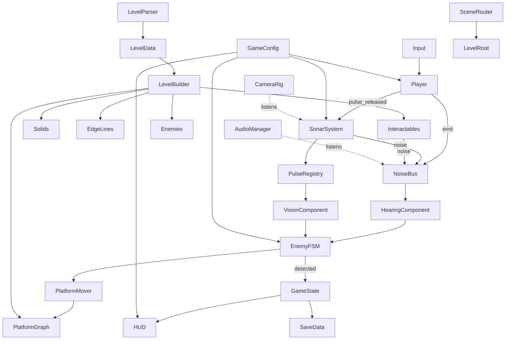

# SIGNAL LOST — Technical Architecture (v1.0)

Godot 4.4, typed GDScript, 2D, **Compatibility renderer**. Files snake_case, classes PascalCase (`class_name`), signals snake_case past tense, constants UPPER_SNAKE.

## 1. Platformer controller, platforms, navigation, layers
- **Controller:** `CharacterBody2D` + `move_and_slide()`, `up_direction = Vector2.UP`, `floor_snap_length = 6`, `floor_max_angle = 50°`. Hand-written accel/friction/coyote/buffer in `player_motor.gd`. *Why:* full control over feel, no physics jitter.
- **One-way platforms:** `StaticBody2D` on physics layer **2 (one_way)** with `CollisionShape2D.one_way_collision = true`, margin 4. Drop-through = player clears mask bit 2 for `drop_through_time`. *Why:* simplest robust Godot 4 pattern.
- **Navigation: custom platform graph on `AStar2D`** built by `PlatformGraph` from the ASCII grid. Nodes = standable cells (empty cell with solid/one-way cell below). Edges: WALK (horizontal neighbours), DROP (walk off an edge, land ≤ 8 tiles below, horizontal 1 cell), JUMP (rise ≤ 2 tiles, horizontal ≤ 3 tiles, head clearance checked on grid), plus one-way drop-through (DROP from a one-way cell straight down). Edge carries `type` metadata. *Why:* `NavigationRegion2D` is top-down; platform AI needs jump/drop semantics; grid A* is O(E log V) on ≤ ~600 nodes — trivial.
- **Parallax & foreground:** `Parallax2D` × 3 (scroll_scale 0.35 / 0.6 / 0.85) under `BackgroundRoot`; foreground solids are black `Polygon2D` + `EdgeLines` node (noise-displaced `Line2D`s). All lit-only content uses `flat_reveal.gdshader`.

### Physics layers (Project Settings → Layer Names → 2D Physics)
| Bit | Name | Used by |
|---|---|---|
| 1 | world | solid cells, closed doors, glass |
| 2 | one_way | `=` platforms |
| 3 | player | player body |
| 4 | enemy | enemy bodies |
| 5 | interactable | Area2D triggers |
| 6 | projectile | sentry bolts |
| 7 | hazard_kill | kill zones (fall) |
Raycasts for hearing / reveal LOS use mask = world (1) only.

### Light / render layers (CanvasItem `light_mask`, light `range_item_cull_mask`)
| Bit | Name | Content |
|---|---|---|
| 1 | world_fg | edge lines, specks, doors, props |
| 2 | world_bg | parallax silhouettes |
| 3 | actors | enemies, player body, items |
| 4 | air | the `SonarAir` full-rect (ring arcs) |

## 2. Sonar reveal rendering — decision: **Hybrid A (lights) + per-material pulse array for arcs**
**Chosen:** `CanvasModulate(#000000)` darkens the whole gameplay canvas. Each bubble is a `PulseBubble` node owning a `PointLight2D` (blend ADD, `shadow_enabled = true`, `shadow_filter = PCF5`, `shadow_filter_smooth = 1.5`) whose texture is a generated **soft-edged disc** (`RevealTextureFactory`, 512×512, plateau to 0.82 r then smooth falloff → the dark vignette edge). `texture_scale` animates with the wavefront radius; `energy` follows the fade curve. All solid cells carry `LightOccluder2D`, so walls/floors clip the dome for free. Every lit-only CanvasItem uses `flat_reveal.gdshader` whose `light()` flattens lighting into crisp silhouettes with a soft rim near the boundary.
**Arcs/wavefront lines:** one full-level `ColorRect` named `SonarAir` (light layer 4) with `sonar_air.gdshader`: its `fragment()` analytically draws thin rings from `uniform vec4 pulse_data[6]` (x, y, radius, alpha) and `uniform vec4 pulse_style[6]` (thickness, trail_gap, trail_count, tier); its `light()` passes colour only where the pixel is lit (so arcs are shadow-clipped by the same occluders). `SonarSystem` writes these arrays every frame.
**Why:** occlusion is solved by Godot's 2D shadow pipeline (no custom raymarch), works in Compatibility, and many overlapping bubbles are additive lights.
**Fallback (if shadows misbehave / too slow on a GPU):** `GameConfig.sonar_quality = LOW` → light shadows off, `pulse_data` also passed to `flat_reveal` (distance-only reveal, no occlusion) and wall occlusion approximated by hiding enemies failing a CPU raycast. Same scenes, flag-switched.

| Concern | Handling |
|---|---|
| Occlusion | `LightOccluder2D` on merged solid rectangles + closed doors + glass. One-way platforms don't occlude. |
| Fade / echo | `energy = base_energy * fade(age)`; then ghost energy 0.12 for `ghost_time`, then free (pooled). Curve in SHADER_SPEC §1. |
| Many pulses | Pool of **6** `PulseBubble`s (+ player glow light = 7 lights ≤ Compatibility default 8 lights/item). Oldest recycled. |
| Ripples of sounds (enemy noises, lanterns, plates) | **unshaded** `RippleRings` node (`_draw()` arcs, `CanvasItemMaterial.light_mode = UNSHADED`) so sounds are seen in darkness. |
| Sensed smudges | `CanvasLayer` "SenseLayer" (layer 2, `follow_viewport_enabled = true`) outside CanvasModulate with `smudge_blur.gdshader`. |
| CPU knowledge of reveal | `PulseRegistry.reveal_at(pos) -> float` = max over bubbles of brightness if `dist < radius` and raycast(origin→pos, mask world) clear. Used for awareness bars, enemy sight of player, sentry targeting. |

## 3. Hearing / noise
`NoiseBus` autoload: `noise_emitted(event: NoiseEvent)`. `NoiseEvent` (RefCounted): `position: Vector2, radius: float, loudness: float, type: NoiseType {PULSE, FOOTSTEP, LAND, IMPACT, GLASS, CLINK, PLATE, DECOY, ENEMY}, source: Node`.
Each `HearingComponent` registers in group `listeners`; NoiseBus iterates the group (≤ 12 enemies) and calls `consider(event)`:
1. `d = distance`; reject if `d > radius * mult * 1.0` (cheap reject).
2. Count walls between with **repeated raycasts** (max 3, each excluding prior hit collider RID) → `walls`.
3. `d_eff = d * (1 + wall_penalty * walls)`, `wall_penalty = 0.75`.
4. Heard iff `loudness >= threshold` and `type` accepted and `d_eff <= radius * mult`.
5. Delivered after `d / sound_speed` seconds (`get_tree().create_timer`) → `heard(event, strength)`, `strength = 1 - d_eff/(radius*mult)`.
*Why:* ≤ 4 raycasts × ≤ 12 enemies per noise event, events are rare (≤ ~5/s) → negligible cost; path-distance attenuation is overkill.

## 4. Pathfinding — custom `AStar2D` platform graph (see §1). `PlatformMover` component follows edge lists (walk: steer; jump: impulse with computed vy; drop: walk off / drop-through).

## 5. Level format — ASCII files `res://levels/level_XX.txt`
Header lines start with `;` as `key=value` (`name`, `decoys`, `seed`, `music`), then grid rows (all same width ≤ 40, height ≤ 22). Tile 32 px; cell (c, r) top-left at `(c*32, r*32)`. Full legend in LEVEL_DESIGN.md. `LevelParser` → `LevelData`; `LevelBuilder` instantiates. Solids are greedily merged into rectangles (row runs, then vertically merged identical runs) → one `StaticBody2D` "Solids" with N `CollisionShape2D` + N `LightOccluder2D` + black `Polygon2D`s; `EdgeBuilder` emits exposed-edge Line2Ds.

## 6. State machines — node-based
`StateMachine` (Node) with child `State` nodes (`enter(msg: Dictionary)`, `exit()`, `update(delta)`, `physics_update(delta)`, `transition_requested` signal). Each state file < 120 lines; owner reference via `@export var actor: EnemyBase`. *Why:* small files per state = ideal for AI-authored code and debug overlay can print `state_machine.current.name`.

## 7. Autoloads (order matters)
| Name | Script | Responsibility |
|---|---|---|
| `GameConfig` | `autoload/game_config.gd` | loads `default_config.tres` (`GameConfigData`), exposes `cfg`, pulse profiles, enemy profiles, palette; applies user settings overrides |
| `Palette` | `autoload/palette_service.gd` | current palette (normal / colour-blind), `color(name)`, signal `palette_changed` |
| `NoiseBus` | `autoload/noise_bus.gd` | noise event routing + hearing delay |
| `PulseRegistry` | `autoload/pulse_registry.gd` | list of active bubbles (data only), `reveal_at()`, `player_revealed()` |
| `GameState` | `autoload/game_state.gd` | current level index, run stats, keycard flag, decoys, emits run signals |
| `AudioManager` | `autoload/audio_manager.gd` | buses, procedural SFX playback pool, music layers, reverb size |
| `SceneRouter` | `autoload/scene_router.gd` | scene changes with fade, restart, level loading |
| `SaveData` | `autoload/save_data.gd` | `user://save.cfg` (ConfigFile): progress, medals, settings |
| `DebugFlags` | `autoload/debug_flags.gd` | F1 overlay toggles, `log(cat, msg)` |

## 8. Folder tree (every planned file)
```
res://
  project.godot
  README.md  CHANGELOG.md
  docs/ (this plan)
  assets/fonts/Rajdhani-Medium.ttf, Rajdhani-SemiBold.ttf, OFL.txt
  autoload/ game_config.gd palette_service.gd noise_bus.gd pulse_registry.gd game_state.gd
            audio_manager.gd scene_router.gd save_data.gd debug_flags.gd
  scripts/resources/ game_config_data.gd pulse_profile.gd enemy_profile.gd level_data.gd palette_data.gd
  scripts/core/ noise_event.gd state_machine.gd state.gd math_util.gd
  resources/config/ default_config.tres
  resources/pulses/ pulse_whisper.tres pulse_normal.tres pulse_scream.tres pulse_decoy.tres
  resources/enemies/ enemy_listener.tres enemy_sentry.tres enemy_hunter.tres enemy_brute.tres
  resources/theme/ palette_default.tres palette_colorblind.tres ui_theme.tres
  shaders/ flat_reveal.gdshader sonar_air.gdshader edge_line.gdshader smudge_blur.gdshader
           enemy_silhouette.gdshader post_fx.gdshader glass_crack.gdshader title_glitch.gdshader
  scenes/main/ main.tscn main.gd boot.gd
  scenes/player/ player.tscn player.gd player_motor.gd pulse_charger.gd battery.gd
                 footstep_emitter.gd player_visual.tscn player_visual.gd death_burst.tscn
  scenes/sonar/ sonar_system.tscn sonar_system.gd pulse_bubble.tscn pulse_bubble.gd
                reveal_texture_factory.gd ripple_rings.gd charge_rings.gd
  scenes/world/ edge_builder.gd edge_line_factory.gd background_builder.gd bg_prop_factory.gd
  scenes/level/ level_root.tscn level_root.gd level_parser.gd level_builder.gd solid_merger.gd
                platform_graph.gd level_validator.gd entity_spawner.gd
  scenes/enemies/ enemy_base.tscn enemy_base.gd hearing_component.gd vision_component.gd
                  platform_mover.gd noise_memory.gd awareness.gd smudge.tscn smudge.gd
                  listener.tscn sentry.tscn hunter.tscn brute.tscn projectile.tscn projectile.gd
                  visuals/ listener_visual.tscn listener_visual.gd sentry_visual.tscn sentry_visual.gd
                           hunter_visual.tscn hunter_visual.gd brute_visual.tscn brute_visual.gd
                  states/ st_patrol.gd st_investigate.gd st_search.gd st_chase.gd st_return.gd
                          st_sentry_idle.gd st_sentry_aim.gd st_sentry_fire.gd st_hunter_track.gd
                          st_brute_wander.gd st_brute_charge.gd st_stunned.gd
  scenes/interactables/ interactable.tscn interactable.gd keycard.tscn keycard.gd door.tscn door.gd
                  one_way_door.tscn one_way_door.gd pressure_plate.tscn pressure_plate.gd
                  glass_floor.tscn glass_floor.gd lantern.tscn lantern.gd vent.tscn vent.gd
                  exit_terminal.tscn exit_terminal.gd fragment.tscn fragment.gd
                  decoy_pickup.tscn decoy_beacon.tscn decoy_beacon.gd hint_sign.tscn hint_sign.gd
  scenes/fx/ camera_rig.tscn camera_rig.gd post_fx.tscn post_fx.gd particles_factory.gd hitstop.gd
  scenes/ui/ hud.tscn hud.gd battery_bar.gd ability_slot.tscn ability_slot.gd pip_row.gd
             level_label.gd fragment_counter.gd awareness_bar.tscn awareness_bar.gd
             world_reticle.tscn world_reticle.gd main_menu.tscn main_menu.gd title_logo.gd
             pause_menu.tscn pause_menu.gd level_complete.tscn level_complete.gd
             settings_menu.tscn settings_menu.gd level_select.tscn level_select.gd ui_button.gd
  scenes/debug/ debug_overlay.tscn debug_overlay.gd debug_draw.gd
  audio/ synth.gd sfx_library.gd music_layers.gd
  levels/ level_01.txt … level_08.txt  level_test.txt
  sandbox/ sandbox_player.tscn sandbox_sonar.tscn sandbox_sonar.gd sandbox_enemy.tscn sandbox_ui.tscn
  tests/ run_tests.gd test_level_parser.gd test_validator.gd test_hearing.gd test_pulse_tiers.gd test_platform_graph.gd
```

## 9. Scene trees
```
Main (Node) main.gd
├─ LevelHost (Node2D)              ← SceneRouter puts LevelRoot here
├─ PostFx (CanvasLayer 10)        post_fx.tscn
├─ HUD (CanvasLayer 20)           hud.tscn
├─ Menus (CanvasLayer 30)
└─ DebugOverlay (CanvasLayer 100)

LevelRoot (Node2D) level_root.gd
├─ CanvasModulate (#000000)
├─ BackgroundRoot (Node2D)  → Parallax2D Far/Mid/Near (light_mask 2)
├─ SonarAir (ColorRect, light_mask 4, sonar_air.gdshader, covers map + 2 tiles)
├─ Solids (StaticBody2D layer 1) → CollisionShape2D*, LightOccluder2D*, Polygon2D*(black)
├─ OneWays (StaticBody2D layer 2)
├─ EdgeLines (Node2D, light_mask 1)
├─ Interactables (Node2D)
├─ Enemies (Node2D)
├─ Player (player.tscn)
├─ SonarSystem (Node2D) → PulseBubble x6 (pooled), RippleRings, (owns air material ref)
├─ CameraRig (camera_rig.tscn)
└─ SenseLayer (CanvasLayer 2, follow_viewport) → smudges, WorldReticles, AwarenessBars

Player (CharacterBody2D, layer 3, mask 1|2|5) player.gd
├─ CollisionShape2D (CapsuleShape2D r7 h18)
├─ PlayerMotor (Node) player_motor.gd
├─ PulseCharger (Node) pulse_charger.gd
├─ Battery (Node) battery.gd
├─ FootstepEmitter (Node) footstep_emitter.gd
├─ GlowLight (PointLight2D r40, energy 0.6, shadows on, cull 1|2|3)
├─ ChargeRings (Node2D, unshaded) charge_rings.gd
└─ Visual (player_visual.tscn)  ← swappable

EnemyBase (CharacterBody2D layer 4) enemy_base.gd  [@export profile: EnemyProfile]
├─ CollisionShape2D
├─ HearingComponent, VisionComponent, NoiseMemory, Awareness, PlatformMover (Nodes)
├─ StateMachine → states…
├─ Hitbox (Area2D mask 3) → kill player
└─ Visual (…_visual.tscn)  ← swappable, light_mask 3, enemy_silhouette.gdshader
```

## 10. System dependencies


## 11. Signal map
| Signal | Emitter | Listeners | Payload |
|---|---|---|---|
| `charge_started()` | PulseCharger | ChargeRings, HUD.BatteryBar, AudioManager | — |
| `charge_changed(tier:int, c:float, affordable_tier:int)` | PulseCharger | ChargeRings, BatteryBar | |
| `pulse_released(profile:PulseProfile, origin:Vector2)` | PulseCharger | SonarSystem, GameState, CameraRig, AudioManager | |
| `pulse_failed()` | PulseCharger | AudioManager, BatteryBar | |
| `energy_changed(value:float, max:float)` | Battery | BatteryBar | |
| `bubble_spawned(bubble:PulseBubble)` | SonarSystem | interactables (lantern, glass via group call), PostFx | |
| `wavefront_passed(bubble, node)` | SonarSystem (group `wave_reactive`) | Lantern, GlassFloor | via `on_wavefront(profile, origin)` method call |
| `noise_emitted(event:NoiseEvent)` | NoiseBus | HearingComponent (direct), AudioManager, RippleRings, DebugOverlay | |
| `heard(event, strength)` | HearingComponent | owner FSM states | |
| `player_spotted(enemy)` | VisionComponent | FSM | |
| `state_changed(enemy, from:StringName, to:StringName)` | StateMachine | DebugOverlay, AudioManager (alert stinger), GameState (if to==chase) | |
| `awareness_changed(enemy, value:float)` | Awareness | AwarenessBar | |
| `player_died(cause:StringName)` | Player | GameState, CameraRig, HitStop, SceneRouter | |
| `keycard_collected()` | Keycard | GameState, HUD | |
| `fragment_collected(id:int)` | Fragment | GameState, HUD | |
| `plate_pressed(id:int)` | PressurePlate | Door(R) via group `plate_doors` | |
| `glass_broken(pos)` | GlassFloor | NoiseBus (emits), PostFx | |
| `level_completed(stats:Dictionary)` | ExitTerminal → GameState | SceneRouter, LevelComplete UI, SaveData | |
| `run_stats_changed(stats)` | GameState | HUD, LevelLabel | |
| `detected()` | GameState | PostFx (flash), AudioManager | |
| `decoy_thrown / decoy_count_changed(n)` | Player / GameState | HUD PipRow | |
| `palette_changed()` | Palette | all Visuals, HUD | |
| `settings_changed()` | SaveData | PostFx, CameraRig, AudioManager | |

## 12. Input map (Project Settings → Input Map; deadzone 0.25)
| Action | Keyboard / Mouse | Gamepad |
|---|---|---|
| move_left | A, Left | Left stick −X, D-pad Left |
| move_right | D, Right | Left stick +X, D-pad Right |
| jump | Space, W, Up | A (button 0) |
| sneak | Shift, S, Down | LT (axis 4), D-pad Down |
| pulse | Left Mouse, K | X (button 2), RT (axis 5) |
| ability_primary | F | Y (button 3) |
| ability_secondary | G | LB (button 9) |
| restart | R | Back/Select (button 4) |
| pause | Escape | Start (button 6) |
| debug_toggle | F1 | — |
| debug_next_page | F2 | — |

## 13. Resources
- `PulseProfile`: `id:StringName, reveal_radius, noise_mult, loudness, hold_time, fade_time, energy_cost, cooldown, ring_thickness, trail_count, shake_px, zoom_punch, sfx_pitch, ca_strength` (+ `noise_radius()` func).
- `EnemyProfile`: `walk_speed, run_speed, hearing_threshold, hearing_mult, accepted_types:Array[int], sight_range, sight_angle_deg, search_time, investigate_wait, awareness_gain, awareness_decay, can_jump, contact_kills, tint:Color`.
- `LevelData`: `name, decoys, seed, width, height, grid:PackedStringArray, cells:Dictionary(char→Array[Vector2i]), player_spawn:Vector2i, exit_cell:Vector2i`.
- `GameConfigData`: all player/battery/sound/fade/camera/post numbers from GDD + `max_bubbles=6, sound_speed=700, wall_penalty=0.75, ghost_energy=0.12, ghost_time=2.0, sonar_quality`.
- `PaletteData`: `bg, far, mid, near, white, danger, smudge, arc:Color, hatch:bool`.

## 14. Performance budget (60 FPS, Intel UHD 620 class)
Lights ≤ 7 on screen (6 bubbles + glow). Occluder rectangles ≤ 150/level (merged). Enemies ≤ 12. Particles: CPUParticles2D only (Compatibility-safe), ≤ 300 alive. Line2D edge points ≤ 4000/level. Post-FX one full-screen pass. Degrade order (`sonar_quality` LOW / Settings "Performance"): shadow filter PCF5→NONE, grain off, bubbles 6→4, parallax near layer off.

## 15. Debug overlay (F1, mandatory)
Pages (F2 cycles): **0 Gameplay** — FPS, player state/velocity, energy, charge tier; noise events drawn as circles (fade 1 s, colour by type); hearing radii per enemy; enemy state labels; nav path polylines; awareness numbers. **1 Graph** — platform graph nodes/edges coloured by type. **2 Render** — bubble list (age, radius, energy), toggle "lights off" (CanvasModulate disabled = see whole level). Drawing via `debug_draw.gd` (world-space Node2D under LevelRoot, unshaded, z_index 100).

## 16. Naming conventions
Files `snake_case.gd/.tscn`; `class_name PascalCase`; nodes PascalCase; unique-name nodes `%Name` for anything a script needs; groups: `listeners`, `wave_reactive`, `plate_doors`, `revealables`, `enemies`, `player`.
