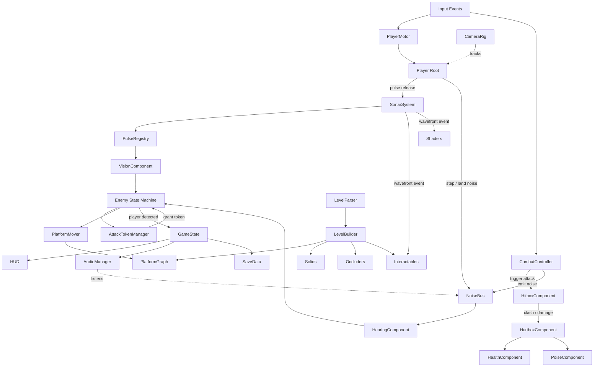

# SIGNAL LOST — Technical Architecture & Migration Specification (V2)

- **Purpose**: Comprehensive technical architecture specification detailing target folder structures, scene hierarchies, component models, signal maps, and an incremental monolith-to-modules migration roadmap.
- **Audience**: Technical Directors, System Architects, Gameplay Engineers, AI Coding Agents.
- **Status**: Approved.
- **Last Updated**: 2026-10-11.
- **Depends On**: [00_CURRENT_STATE_AUDIT.md](file:///c:/vibe-game/docs/00_CURRENT_STATE_AUDIT.md), [PRD.md](file:///c:/vibe-game/docs/PRD.md), [TECH_STACK.md](file:///c:/vibe-game/docs/TECH_STACK.md).

---

## 1. Current Architecture (V1 Baseline Summary)

As established in the [Current State Audit](file:///c:/vibe-game/docs/00_CURRENT_STATE_AUDIT.md):
- **Structure**: 103 files across `autoload/`, `scenes/`, `scripts/`, `shaders/`, `audio/`, `levels/`, and `tests/`.
- **Strengths**: Proven echolocation reveal pipeline (`SonarSystem` + `flat_reveal.gdshader`), distance-field air ring shader (`sonar_air.gdshader`), physical acoustic attenuation bus (`NoiseBus`), and automated CI test infrastructure (`tests/run_tests.gd` and Playwright E2E).
- **Core Architectural Weaknesses**:
  1. **Tight Autoload God-Object Coupling**: `GameState` tracks run statistics, active level indices, keycard collection, decoy inventory, and pulse profiles simultaneously.
  2. **Duck-Typed Interaction & Missing Combat Layer**: Lack of formal `HitboxComponent`, `HurtboxComponent`, or `HealthComponent` primitives; damage is resolved via binary string-cause death callbacks (`die(&"caught")`).
  3. **Fragmented Enemy State Handling**: Enemy FSM states communicate directly with parent nodes via loose string methods rather than typed signals or standardized component contracts.

---

## 2. Target Architecture (V2 Modular System)

### 2.1 Complete Target Folder Hierarchy
```
res://
├── assets/
│   ├── fonts/ (Rajdhani-Medium.ttf, Rajdhani-SemiBold.ttf, OFL.txt)
│   └── icons/ (weapon_katana.svg, weapon_naginata.svg, weapon_kunai.svg)
├── audio/
│   ├── default_bus_layout.tres
│   ├── synth.gd (low-level oscillator and noise generators)
│   ├── sfx_library.gd (procedural SFX cache)
│   └── music_layers.gd (dynamic combat and ambient cross-fader)
├── autoload/
│   ├── game_config.gd (central config resource loader)
│   ├── palette_service.gd (tri-color and color-blind palette provider)
│   ├── noise_bus.gd (acoustic propagation and hearing dispatch)
│   ├── pulse_registry.gd (active bubble spatial query registry)
│   ├── attack_token_manager.gd (NEW: combat AI concurrency coordinator)
│   ├── game_state.gd (campaign level progression and stats)
│   ├── audio_manager.gd (sound bus playback coordinator)
│   ├── scene_router.gd (level transitions and scene loading)
│   ├── save_data.gd (persistent medals, settings, unlocks)
│   ├── debug_flags.gd (F1 overlay toggles and logger)
│   └── debug_bridge.gd (window.__SL and browser E2E command bridge)
├── resources/
│   ├── attacks/ (NEW: typed AttackData resources for all weapons)
│   ├── config/ (default_config.tres, combat_config.tres)
│   ├── enemies/ (enemy_ashigaru.tres, enemy_kenshi.tres, etc.)
│   ├── pulses/ (pulse_whisper.tres, pulse_normal.tres, pulse_scream.tres)
│   └── theme/ (palette_default.tres, palette_colorblind.tres, ui_theme.tres)
├── scenes/
│   ├── combat/ (NEW: reusable combat component primitives)
│   │   ├── hitbox_component.gd / .tscn
│   │   ├── hurtbox_component.gd / .tscn
│   │   ├── health_component.gd / .tscn
│   │   └── poise_component.gd / .tscn
│   ├── debug/ (debug_overlay.tscn, animation_gallery.tscn)
│   ├── enemies/ (ashigaru.tscn, kenshi.tscn, yumi.tscn, brute.tscn, sentry.tscn, boss_shogun.tscn)
│   │   ├── states/ (st_patrol.gd, st_chase.gd, st_thrust.gd, etc.)
│   │   └── visuals/ (ashigaru_visual.gd, kenshi_visual.gd, etc.)
│   ├── fx/ (camera_rig.tscn, post_fx.tscn, slash_arc.tscn, particles_factory.gd)
│   ├── interactables/ (doors, keys, vents, echo_glyph.tscn, resonance_panel.tscn)
│   ├── level/ (level_root.tscn, level_builder.gd, platform_graph.gd, level_validator.gd)
│   ├── main/ (main.tscn, main.gd, boot.gd)
│   ├── player/ (player.tscn, player.gd, player_motor.gd, combat_controller.gd)
│   │   └── visuals/ (player_visual.gd, scarf_physics.gd)
│   ├── sonar/ (sonar_system.tscn, pulse_bubble.tscn, charge_rings.gd)
│   └── ui/ (hud.tscn, main_menu.tscn, pause_menu.tscn, level_complete.tscn, boss_bar.tscn)
├── scripts/
│   ├── core/ (noise_event.gd, state_machine.gd, state.gd, math_util.gd)
│   └── resources/ (attack_data.gd, enemy_profile.gd, pulse_profile.gd, level_data.gd)
├── shaders/ (flat_reveal.gdshader, sonar_air.gdshader, slash_arc.gdshader, post_fx.gdshader)
└── tests/ (run_tests.gd, unit test scripts, e2e browser test scripts)
```

---

## 3. Scene Trees & Node Ownership

### 3.1 Main Scene Tree (`res://scenes/main/main.tscn`)
```
Main (Node) [main.gd]
├── LevelHost (Node2D)                  ← SceneRouter instantiates LevelRoot here
├── PostFx (CanvasLayer 10)             ← Full-screen grain, CA burst, detection flash
├── HUD (CanvasLayer 20)                ← Tactical samurai HUD, health segments, awareness
├── Menus (CanvasLayer 30)              ← MainMenu, PauseMenu, Settings, LevelComplete
└── DebugOverlay (CanvasLayer 100)      ← F1 live telemetry pages, F2 cycle
```

### 3.2 Level Root Scene Tree (`res://scenes/level/level_root.tscn`)
```
LevelRoot (Node2D) [level_root.gd]
├── CanvasModulate (Color #000000)      ← Pure darkness baseline
├── BackgroundRoot (Node2D)             ← Parallax2D Far/Mid/Near shoji silhouettes
├── SonarAir (ColorRect)                ← Air wave distance-field shader (light_mask 4)
├── Solids (StaticBody2D layer 1)       ← Merged collision rects + LightOccluder2D + black Polygons
├── OneWays (StaticBody2D layer 2)      ← Jump-through / drop-through catwalk platforms
├── EdgeLines (Node2D light_mask 1)     ← Procedural torn-paper jagged white edge lines
├── Interactables (Node2D)              ← Doors, resonance panels, glyphs, lanterns, vents
├── Enemies (Node2D)                    ← Spawned enemy instances
├── Player (CharacterBody2D)            ← Player hero instance
├── SonarSystem (Node2D)                ← 6 pooled PulseBubble lights + air shader uniform driver
├── CameraRig (Node2D)                  ← Smooth kinematic camera with dynamic zoom/look-ahead
└── SenseLayer (CanvasLayer 2)          ← Unshaded awareness bars and noise reticles
```

### 3.3 Player Hero Scene Tree (`res://scenes/player/player.tscn`)
```
Player (CharacterBody2D layer 3, mask 1|2|5) [player.gd]
├── CollisionShape2D (CapsuleShape2D 16x48 px)
├── PlayerMotor (Node) [player_motor.gd]
├── CombatController (Node) [combat_controller.gd]  ← NEW: Manages Katana, Naginata, Kunai
│   ├── WeaponKatana (Node) [weapon_katana.gd]
│   ├── WeaponNaginata (Node) [weapon_naginata.gd]
│   └── WeaponKunai (Node) [weapon_kunai.gd]
├── HealthComponent (Node) [health_component.gd]    ← NEW: 3-segment health + i-frames
├── PoiseComponent (Node) [poise_component.gd]      ← NEW: Hero poise and guard break
├── HurtboxComponent (Area2D layer 3, mask 4)       ← NEW: Receives hostile damage
├── PulseCharger (Node) [pulse_charger.gd]          ← Sonar charge timer and tier logic
├── Battery (Node) [battery.gd]                      ← 100 energy units + regen curves
├── FootstepEmitter (Node) [footstep_emitter.gd]    ← Movement noise generation
├── GlowLight (PointLight2D r40 px)                 ← Faint ambient hero self-glow
├── ChargeRings (Node2D unshaded) [charge_rings.gd] ← Concentric charge indicators
└── Visual (Node2D light_mask 3) [player_visual.gd]
    ├── Chassis (Polygon2D)                         ← White articulated samurai silhouette
    ├── KatanaScabbard (Line2D)                     ← Hip-mounted sheathed blade
    └── Scarf (Line2D) [scarf_physics.gd]           ← Dynamic Verlet physics scarf
```

### 3.4 Standardized Enemy Scene Tree (`res://scenes/enemies/enemy_base.tscn`)
```
EnemyBase (CharacterBody2D layer 4, mask 1|2|3) [enemy_base.gd]
├── CollisionShape2D
├── PlatformMover (Node) [platform_mover.gd]        ← Custom A* edge follower with stuck recovery
├── HearingComponent (Node) [hearing_component.gd]  ← Distance attenuation + wall raycasts
├── VisionComponent (Node) [vision_component.gd]    ← Cone checks in lit bubbles
├── AwarenessComponent (Node) [awareness.gd]        ← Awareness accumulation and decay
├── HealthComponent (Node) [health_component.gd]    ← HP tracking and death signals
├── PoiseComponent (Node) [poise_component.gd]      ← Poise meter and stagger states
├── HurtboxComponent (Area2D layer 4, mask 3)       ← Takes damage from player weapons
├── HitboxComponent (Area2D layer 4, mask 3)        ← Deals damage to player
├── StateMachine (Node) [state_machine.gd]          ← Patrol, Investigate, Chase, Attack states
└── Visual (Node2D light_mask 3) [*_visual.gd]      ← Distinct red silhouette + weapon stance
```

---

## 4. System Dependency Architecture



---

## 5. Standardized Component Model

To eliminate duck-typing and fragile string callbacks, all combat and health interactions use typed components:

### 5.1 `HealthComponent` (`scenes/combat/health_component.gd`)
- Responsibilities: Manages integer health segments, handles invulnerability frames (`i-frames`), emits damage/death signals.
- Signals: `health_changed(current: int, max: int)`, `damaged(amount: int, knockback: Vector2)`, `died(cause: StringName)`.
- Public API: `take_damage(amount: int, knockback: Vector2) -> bool`, `heal(amount: int)`, `is_alive() -> bool`.

### 5.2 `PoiseComponent` (`scenes/combat/poise_component.gd`)
- Responsibilities: Tracks physical balance meter (0.0 to 100.0), applies poise damage, triggers stagger or guard break when depleted.
- Signals: `poise_changed(current: float, max: float)`, `staggered(duration: float)`, `guard_broken()`.
- Public API: `damage_poise(amount: float) -> bool`, `reset_poise()`.

### 5.3 `HitboxComponent` (`scenes/combat/hitbox_component.gd`)
- Responsibilities: `Area2D` sub-class that deals damage upon intersecting a `HurtboxComponent`.
- Properties: `@export var damage: int = 1`, `@export var poise_damage: float = 20.0`, `@export var knockback_force: float = 250.0`, `@export var hitstop_duration: float = 0.08`, `@export var attack_data: AttackData`.

### 5.4 `HurtboxComponent` (`scenes/combat/hurtbox_component.gd`)
- Responsibilities: `Area2D` sub-class that receives damage from a `HitboxComponent` and routes it to sibling `HealthComponent` and `PoiseComponent`.
- Signals: `hit_received(hitbox: HitboxComponent)`.

---

## 6. Autoload Singletons & Responsibilities

| Singleton Name | Script Path | Single Architectural Responsibility |
|---|---|---|
| `GameConfig` | `autoload/game_config.gd` | Loads centralized config resources (`default_config.tres`); provides readonly tunables. |
| `Palette` | `autoload/palette_service.gd` | Provides active tri-color palette tokens and color-blind hatch patterns. |
| `NoiseBus` | `autoload/noise_bus.gd` | Routes `NoiseEvent` physics, wall raycast attenuation, and delivery delay queues. |
| `PulseRegistry` | `autoload/pulse_registry.gd` | Maintains spatial registry of active sonar bubbles for instant CPU reveal queries. |
| `AttackTokenManager` | `autoload/attack_token_manager.gd` | NEW: Coordinates enemy attack concurrency (maximum 2 simultaneous attack tokens). |
| `GameState` | `autoload/game_state.gd` | Tracks campaign sector index, run timers, fragments collected, and medals earned. |
| `AudioManager` | `autoload/audio_manager.gd` | Manages procedural audio buses, dynamic music cross-fading, and SFX playback. |
| `SceneRouter` | `autoload/scene_router.gd` | Handles smooth screen fades, level loading, and level restart lifecycles. |
| `SaveData` | `autoload/save_data.gd` | Serializes sector medals, settings, and fragments to `user://save.cfg`. |
| `DebugFlags` | `autoload/debug_flags.gd` | Manages F1 overlay categories and runtime debug printing. |
| `DebugBridge` | `autoload/debug_bridge.gd` | Bridges live game telemetry to `window.__SL` and executes Playwright test commands. |

---

## 7. Comprehensive Signal Map

| Signal Name | Emitter Class | Direct Listeners | Payload Arguments | Purpose |
|---|---|---|---|---|
| `pulse_released` | `PulseCharger` | `SonarSystem`, `GameState`, `CameraRig` | `profile: PulseProfile, pos: Vector2` | Spawns expanding sonar bubble |
| `noise_emitted` | `NoiseBus` | `HearingComponent`, `AudioManager`, `DebugOverlay` | `event: NoiseEvent` | Routes physical sound wave |
| `attack_started` | `CombatController` | `PlayerVisual`, `NoiseBus` | `attack_data: AttackData` | Triggers weapon slash animation |
| `parry_successful` | `CombatController` | `AudioManager`, `CameraRig`, `HitStop` | `attacker_pos: Vector2` | Sparks, screen shake, i-frames |
| `poise_depleted` | `PoiseComponent` | `StateMachine` | `duration: float` | Transitions enemy into STAGGER |
| `health_changed` | `HealthComponent` | `HUD.HealthBar`, `BossBar` | `current: int, max_health: int` | Updates segmented UI meters |
| `token_granted` | `AttackTokenManager`| `EnemyFSM` | `token_id: int` | Authorizes enemy attack strike |
| `wavefront_passed`| `SonarSystem` | `Lantern`, `GlassFloor`, `ResonancePanel` | `profile: PulseProfile, origin: Vector2` | Triggers reactive environment nodes |
| `level_completed` | `ExitTerminal` | `GameState`, `SceneRouter`, `LevelComplete` | `stats: Dictionary` | Opens victory screen and saves |
| `detected` | `GameState` | `PostFx`, `AudioManager.MusicLayers` | — | Triggers screen flash & taiko music |

---

## 8. Monolith-to-Modules Migration Plan (Ordered Safe Extraction)

To transition safely without breaking any working V1 system, changes are executed in **10 discrete, testable extraction steps**. Every step must pass both headless unit tests and browser regression gates before moving to the next:

```
[CURRENT CODEBASE]
       │
       ▼ Step 1: Health & Combat Components Extraction (Zero behavior change)
       │         → Run: test_health_system.gd (PASS)
       ▼ Step 2: AttackTokenManager Singleton Creation
       │         → Run: test_attack_tokens.gd (PASS)
       ▼ Step 3: PlayerMotor & CombatController Decoupling
       │         → Run: test_gate_a.js (PASS 30s movement)
       ▼ Step 4: Weapon Data Resources & Katana Implementation
       │         → Run: test_combat_combo.gd (PASS)
       ▼ Step 5: Enemy Base Health/Poise Integration
       │         → Run: test_step_e.js (PASS enemy hearing)
       ▼ Step 6: PlatformGraph Stuck-Detection Hardening
       │         → Run: test_platform_graph.gd (PASS)
       ▼ Step 7: Vertical Levels Ingestion & Validator Overhaul
       │         → Run: test_validator.gd (PASS 0 soft-locks)
       ▼ Step 8: Puzzle Tooling Component Extraction
       │         → Run: test_puzzle_glyphs.gd (PASS)
       ▼ Step 9: Visual Chassis & Scarf Physics Integration
       │         → Run: test_step_c.js (PASS visual check)
       ▼ Step 10: Dynamic Music Layering & Final Polish
                 → Run: test_soak.js (PASS 60s soak test)
[TARGET ARCHITECTURE]
```

### Detailed Extraction Steps:
1. **Step 1: Extract Combat Primitives (`HealthComponent`, `PoiseComponent`, `HitboxComponent`, `HurtboxComponent`)**:
   - Create scripts in `res://scenes/combat/`.
   - Wire `HealthComponent` into `Player` with 3 segments default. If health hits 0, emit `player_died(&"caught")`.
   - *Regression Check*: All 17 unit tests pass; `test_gate_a.js` passes.
2. **Step 2: Implement `AttackTokenManager` Autoload**:
   - Register singleton in `project.godot`. Provides `request_token(actor)` and `release_token(actor)`.
   - *Regression Check*: Unit test `test_attack_tokens.gd` passes.
3. **Step 3: Decouple `CombatController` from `Player`**:
   - Move attack input handling out of `player.gd` into `scenes/player/combat_controller.gd`.
   - *Regression Check*: Player movement, sneaking, and pulse charging remain 100% functional.
4. **Step 4: Implement Katana Slashing & Noise Bus Emission**:
   - Add `WeaponKatana` executing 3-hit combo and emitting `NoiseEvent.COMBAT` on each strike.
   - *Regression Check*: Run `test_combat_combo.gd` and verify noise events received by `NoiseBus`.
5. **Step 5: Refactor EnemyBase with `HurtboxComponent` and `PoiseComponent`**:
   - Standardize `Ashigaru` and `Listener` to take damage from player hitboxes.
   - *Regression Check*: Run `test_step_e.js`; enemies continue patrolling, hearing, and chasing normally.
6. **Step 6: Enhance `PlatformGraph` with Directed Ledge Recovery**:
   - Add jump-impulse recovery heuristics to `scenes/level/platform_graph.gd` for vertical traversal.
   - *Regression Check*: Run `test_platform_graph.gd` and `test_validator.gd`.
7. **Step 7: Deploy Vertical Level Pipeline (Levels 1–9)**:
   - Ingest updated level files. Run `LevelValidator` ensuring zero soft-locks and verified return paths.
   - *Regression Check*: Run `test_validator.gd` across all 9 maps.
8. **Step 8: Deploy Escape-Room Puzzle Primitives**:
   - Implement `EchoGlyph`, `ResonancePanel`, `HarmonicLantern`, and `SealLock`.
   - *Regression Check*: Run `test_puzzle_resonance.gd`.
9. **Step 9: Upgrade Visuals to Vector Samurai & Scarf**:
   - Connect `player_visual.gd` and `scarf_physics.gd`. Update camera zoom parameters in `camera_rig.gd`.
   - *Regression Check*: Run `test_step_c.js`; verify visual chassis and camera framing.
10. **Step 10: Dynamic Taiko Percussion & Full System Soak**:
    - Connect `music_layers.gd` to `GameState.detected()`. Execute 60-second continuous gameplay soak.
    - *Regression Check*: Run `test_soak.js` across all levels with 0 errors.
