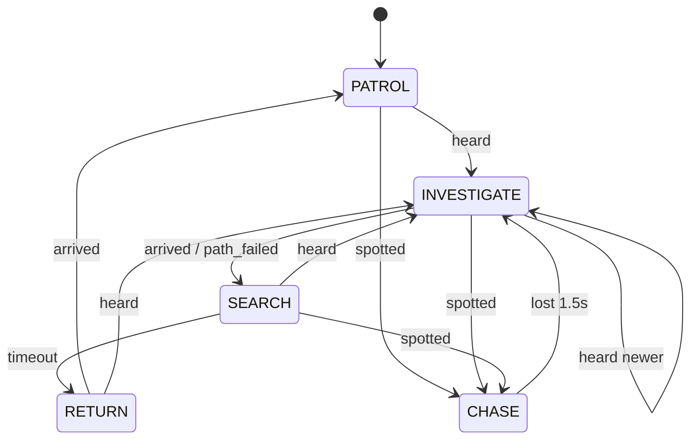

# SIGNAL LOST — Enemy AI (v1.0)

## 1. Shared components
| Component | Responsibility |
|---|---|
| `HearingComponent` | registered in group `listeners`; `consider(event)` math below; emits `heard(event, strength)` after propagation delay |
| `VisionComponent` | every 0.1 s: player visible iff `PulseRegistry.reveal_at(player) > 0.25` AND dist ≤ `sight_range` AND angle to facing ≤ `sight_angle/2` AND raycast clear (mask world). Emits `player_spotted(pos)` / `player_lost()` |
| `NoiseMemory` | ring buffer of last N noise origins (Listener/Brute N=1, Hunter N=3), entries `{pos, time, strength}`; entries older than 20 s expire |
| `Awareness` | float 0..1; `+= profile.awareness_gain * (0.35 + 0.65*strength)` on heard; `= 1` on spotted; decays `profile.awareness_decay`/s when nothing new; emits `awareness_changed` |
| `PlatformMover` | `move_to(world_pos, speed)` → nearest graph node path via `PlatformGraph.find_path(from, to)`; executes WALK/JUMP/DROP; emits `arrived`, `path_failed` |
| `StateMachine` | node-based; `transition_to(name, msg := {})`; emits `state_changed` |

### Hearing math (formal)
For event `e` and listener at `p` with profile `(T, m, A)` (threshold, multiplier, accepted types):
```
d     = |p - e.position|
R     = e.radius * m
if e.type ∉ A or e.loudness < T or d > R*1.0: reject      (wall count can only increase d_eff)
w     = walls_between(e.position, p)  ∈ {0..3}   (repeated raycasts, mask=world)
d_eff = d * (1 + 0.75 * w)
heard iff d_eff ≤ R
strength s = 1 - d_eff / R                         ∈ (0,1]
delivery delay = d / 700  s
```
Inverse-distance intuition: perceived intensity ∝ 1/d; we linearize to `s` for tuning clarity (documented in report notes).

### Contact
Every enemy has `Hitbox` (Area2D, mask player). On `body_entered(player)` → `player.die(&"caught")` if `profile.contact_kills`. Sentry has no hitbox; its projectiles kill.

## 2. Profiles (`resources/enemies/*.tres`)
| Field | Listener | Sentry | Hunter | Brute |
|---|---|---|---|---|
| walk_speed | 50 | 0 | 90 | 40 |
| run_speed | 120 | 0 | 230 | 110 |
| turn_speed (deg/s) | — | 60 | — | — |
| hearing_threshold | 1.0 | 3.0 | 0.5 | 0.5 |
| hearing_mult | 1.0 | 1.0 | 1.25 | 2.5 |
| accepted_types | all except ENEMY | PULSE, GLASS, DECOY, IMPACT | all except ENEMY | FOOTSTEP, LAND, GLASS(stomp only) |
| sight_range | 200 | 320 | 240 | 0 |
| sight_angle_deg | 70 | 40 | 90 | 0 |
| investigate_wait | 1.5 s | — | 0.6 s | 1.0 s |
| search_time | 4.0 s | — | 2.5 s | 3.0 s |
| awareness_gain | 0.6 | 1.0 | 0.8 | 0.7 |
| awareness_decay | 0.15/s | 0.25/s | 0.1/s | 0.2/s |
| can_jump | true | false | true | false |
| memory_size | 1 | 1 | 3 | 1 |
| fire_interval | — | 0.9 s | — | — |
| projectile_speed | — | 420 px/s | — | — |

## 3. Listener (patrolling drone-walker)
Patrol range: walks its starting floor segment between walls/edges (or invisible `|` marker cells), turning with a 0.6 s pause.
| State | Enter | Update | Exit | Transitions |
|---|---|---|---|---|
| PATROL | speed=walk; resume patrol dir | walk; turn at segment end (pause 0.6 s) | — | heard → INVESTIGATE(pos); spotted → CHASE |
| INVESTIGATE | "?" tell; mover.move_to(noise.pos, walk*1.4 = 70) | on newer heard → retarget | stop | arrived → SEARCH; path_failed → SEARCH at nearest reachable; spotted → CHASE |
| SEARCH | timer=search_time | flip facing every 1.0 s; scan | — | timer → RETURN; heard → INVESTIGATE; spotted → CHASE |
| CHASE | "!" flash, emit ENEMY noise ripple, GameState.detected(); speed=run | move_to(last_seen) every 0.25 s | — | lost for 1.5 s → INVESTIGATE(last_seen) |
| RETURN | move_to(patrol start) walk | — | — | arrived → PATROL; heard → INVESTIGATE; spotted → CHASE |

Tells: antenna ripple ring (red-grey, unshaded) on every state change; "?" glyph (investigate) / "!" (chase) above head for 0.6 s, white-flashed silhouette.

## 4. Sentry (balcony turret)
| State | Enter | Update | Exit | Transitions |
|---|---|---|---|---|
| IDLE | — | sweep ±45° around base facing at 30°/s | — | heard (loud ≥3) → AIM(noise.pos); spotted → AIM(player, tracking) |
| AIM | whine SFX, red dotted laser line (1 px, α0.4, unshaded) toward target; timer 0.6 s | rotate toward target at 60°/s; if tracking, retarget | — | timer & within 5° → FIRE |
| FIRE | spawn Projectile toward target; ENEMY noise ripple (r 160) | — | — | after fire_interval: if still spotted → AIM(tracking); else if fired < 3 at noise → AIM(noise) ; else → IDLE |
Projectile: `Area2D` 6×2 red streak, speed 420, lifetime 2.5 s, dies on world; white reticle ring (r 10 px, 1 px) follows it; kills player on contact; makes IMPACT noise (r 120, loud 1.5) on hitting a wall.

## 5. Hunter (fast, memory of 3 noises)
| State | Enter | Update | Exit | Transitions |
|---|---|---|---|---|
| PATROL | walk | patrol like Listener | — | heard → TRACK |
| TRACK | pop oldest unvisited memory entry; speed = (any entry loudness ≥ 3 within last 2 s) ? run : walk*1.6 | move_to(entry); on heard: push to memory (dedupe within 48 px) | — | arrived → next entry or SEARCH if empty; spotted → CHASE |
| SEARCH | timer 2.5 s; sniff anim | flip facing every 0.6 s | — | timeout → RETURN; heard → TRACK |
| CHASE | as Listener but run=230 and double-ping red ripple every 1 s | — | — | lost 2.0 s → TRACK(last_seen pushed) |
| RETURN | as Listener | — | — | — |
Tell: emits a quiet ENEMY ripple (double ring) every 1.2 s while TRACK — the player can see the hunt.

## 6. Deaf Brute (vibration only)
| State | Enter | Update | Exit | Transitions |
|---|---|---|---|---|
| WANDER | walk | patrol segment; each step (0.7 s) emits a thud ripple (unshaded, ENEMY type → ignored by all) and +0.03 camera shake if within 160 px | — | heard (FOOTSTEP/LAND) → CHARGE(pos) |
| CHARGE | roar tell, red flash, run toward pos (same floor only; never jumps; drops allowed) | stops at edge/wall | — | arrived/blocked → STUNNED |
| STUNNED | 1.2 s head shake (vulnerable window to pass) | — | — | timeout → SEARCH(3 s) → WANDER (returns to segment) |
Also: stepping on `G` glass breaks it (GLASS noise from glass, Brute ignores; others hear). Pulses (any size) are ignored → teaching beat: in level 5 you may Scream freely.

## 7. Mimic (stretch, Phase 10)
Static `Fragment`-shaped visual drawn in white; when revealed, 3% chance per pulse to flicker red for one frame; if player within 24 px → reveals red, lunges 64 px, kills. Never in the core 8 levels.

## 8. Tuning table (single place: the `.tres` profiles; GameConfig only holds global sound constants)
| Global | Value |
|---|---|
| sound_speed | 700 px/s |
| wall_penalty | 0.75 |
| max_wall_raycasts | 3 |
| vision_tick | 0.1 s |
| reveal_visible_threshold | 0.25 |
| memory_expiry | 20 s |
| repath_interval | 0.25 s |

## 9. Debug visualisation (DebugOverlay page 0)
Per enemy: hearing radius ring for a reference Normal pulse (`200 * mult`, dashed, grey), sight cone (white α0.2), state label (`PATROL` etc.) + awareness number, current path polyline, memory entries as small numbered crosses. Noise events: circle of `radius` coloured by type, fading 1 s.
