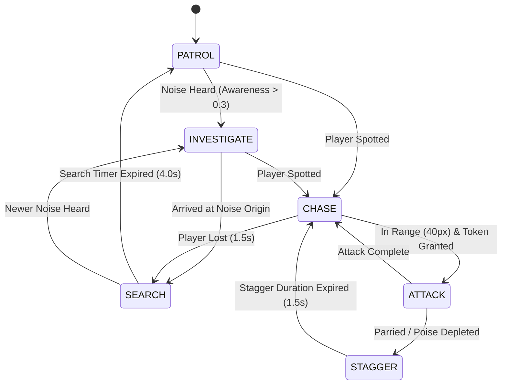

# SIGNAL LOST — Enemy AI & Adversary Behavior Specification (V2)

- **Purpose**: Authoritative artificial intelligence specification detailing enemy silhouettes, state machines, sensory perception (sight, hearing, vibration), combat attacks, platform graph navigation, and the Shogun Mech boss fight.
- **Audience**: AI Engineers, Gameplay Programmers, Level Designers, Technical Directors.
- **Status**: Approved.
- **Last Updated**: 2026-10-11.
- **Depends On**: [00_CURRENT_STATE_AUDIT.md](file:///c:/vibe-game/docs/00_CURRENT_STATE_AUDIT.md), [GAME_CONFIG_REFERENCE.md](file:///c:/vibe-game/docs/GAME_CONFIG_REFERENCE.md), [COMBAT_DESIGN.md](file:///c:/vibe-game/docs/COMBAT_DESIGN.md).

---

## 1. Shared Sensory Perception & Components

Every enemy inherits from `EnemyBase` and shares standardized sensory and decision components:
1. **`HearingComponent`**:
   - Listens to `NoiseBus` events.
   - Evaluates Euclidean distance $d$ and occluding wall count $W$ via repeated line-of-sight raycasts:
     $$d_{eff} = d \cdot (1 + 0.75 \cdot W)$$
   - Registers event if $L_E \ge \theta_{threshold}$ and $d_{eff} \le R_E \cdot m_{sensitivity}$.
   - Delivers event after physical propagation delay $\Delta t = d / 700 \text{ px/s}$.
2. **`VisionComponent`**:
   - Updates every 0.10s.
   - The player is visible **only if** they are currently illuminated by an active sonar bubble ($\text{brightness} > 0.25$) or hero self-glow, inside the enemy's vision cone ($\le \text{angle}/2$), within range, and unobstructed by world geometry. In pure darkness, the player is 100% invisible.
3. **`AwarenessComponent`**:
   - Float meter from 0.0 to 1.0. Accumulates on hearing sound cues; instantly jumps to 1.0 on direct sight. Decays at a profile-defined rate when undisturbed.
4. **`AttackTokenReceiver`**:
   - Requests attack tokens from `AttackTokenManager` before initiating strikes. If denied, circles target or maintains defensive stance.

---

## 2. Standard Adversary Roster

### 2.1 Ashigaru (Spearman Drone)
- **Silhouette**: Lean robotic soldier wearing a conical jingasa helmet, gripping a long yari spear with two hands. Height 58 px.
- **Stats**: HP: 2 segments | Poise: 40.0 | Walk Speed: 50 px/s | Run Speed: 120 px/s.
- **Perception**: Sight: 70° cone, 200 px | Hearing Threshold: 1.0 | Sensitivity: 1.0x | Hears pulses, footsteps, combat slashes.
- **Combat Attacks**:
  - *Spear Thrust*: Startup 27f (0.45s, red blade glint) -> Active 4f -> Recovery 20f. Range 44 px. Damage: 1 segment. Poise Dmg: 25.
  - *Pommel Strike*: Close-range pushback. Startup 16f (0.27s) -> Active 3f -> Recovery 15f. Range 22 px. Deals 15 poise damage (no HP damage).

---

### 2.2 Kenshi (Swordsman Duelist)
- **Silhouette**: Agile armored ronin with a flowing shoulder cape and single katana held in high jodan stance. Height 56 px.
- **Stats**: HP: 3 segments | Poise: 60.0 | Walk Speed: 70 px/s | Run Speed: 160 px/s.
- **Perception**: Sight: 80° cone, 220 px | Hearing Threshold: 1.0 | Sensitivity: 1.0x.
- **Special AI Behavior**:
  - Predictable front slashes have a 40% chance of being deflected by the Kenshi's auto-parry.
  - Can back-dash (12f evasion) when the player charges a heavy attack.
- **Combat Attacks**:
  - *Quick Draw Slash*: Fast step-forward slash. Startup 21f (0.35s) -> Active 3f -> Recovery 18f. Range 36 px. Damage: 1 segment.
  - *Spinning Sweep*: Unblockable sweeping strike. Startup 32f (0.53s, red kanji flash) -> Active 5f -> Recovery 24f. Range 48 px. Damage: 2 segments.

---

### 2.3 Yumi (Balcony Archer)
- **Silhouette**: Hooded, crouched perched silhouette holding an asymmetrical acoustic longbow. Stationed on elevated catwalks. Height 52 px.
- **Stats**: HP: 1 segment | Poise: 20.0 | Walk Speed: 40 px/s | Run Speed: 100 px/s.
- **Perception**: Sight: 40° narrow cone, 400 px range | Hearing Threshold: 0.8 | Sensitivity: 1.2x.
- **Combat Attacks**:
  - *Acoustic Arrow*: Aims laser sight for 42f (0.70s), then fires a high-velocity piercing arrow (520 px/s). Arrow is rendered as a sharp red vector line inside sonar rings. Damage: 1 segment.
  - *Flee / Reposition*: If player approaches within 60 px, drops a flash pellet (0.2s blind) and retreats via platform graph.

---

### 2.4 Oni Brute (Heavy Mech)
- **Silhouette**: Massive hulking mechanical brute with broad spiked shoulders and an oversized iron kanabo club. Height 82 px.
- **Stats**: HP: 6 segments | Poise: 120.0 | Walk Speed: 40 px/s | Run Speed: 110 px/s.
- **Perception**: Blind (0° cone, 0 px sight). Completely deaf to airborne voice pulses. Reacts exclusively to ground vibration (`FOOTSTEP`, `LAND`). Hearing Sensitivity: 2.5x.
- **Special Defenses**:
  - Front armor is 100% immune to light Katana slashes (sparks bounce off with zero damage).
  - Vulnerable only to Naginata heavy thrusts, environmental traps (breakable glass floors), or stealth rear finishers.
- **Combat Attacks**:
  - *Club Ground Slam*: Startup 36f (0.60s) -> Active 6f -> Recovery 30f. Shatters glass floors, emits shockwave ripple (180 px noise). Damage: 2 segments.
  - *Bull Charge*: Sprints in a straight line (260 px/s) until colliding with a solid wall, stunning itself for 2.0s.

---

### 2.5 Sentry (Balcony Turret)
- **Silhouette**: Ceiling/wall-mounted mechanical eye turret with rotating perimeter sensors.
- **Stats**: HP: 1 segment | Poise: 10.0 | Static (0 px/s).
- **Perception**: Scans 40° cone across 320 px, rotating at 60°/s. Alerted by high-amplitude noise (Scream, glass break, decoy, loudness $\ge 3.0$).
- **Combat Attacks**:
  - *Targeting Laser*: Locks red tracking beam on player for 0.60s (36f).
  - *Plasma Bolt*: Fires red lethal projectile at 420 px/s. Can be deflected back into the turret with a Katana parry.

---

## 3. Boss Encounter: The Shogun Mech (Sector 9)

The **Shogun Mech** is the automated warlord of Facility 09: a 120 px tall multi-limbed mechanical daimyo combining acoustic warfare, sword mastery, and room-filling artillery.

### Boss Stats: 18 HP Segments | 200.0 Poise | 3 Combat Phases

| Phase | Health Threshold | Signature Attacks & Telegraphs | Sonar / Acoustic Mechanic | Arena Hazard |
|---|---|---|---|---|
| **Phase 1: The Blade Master** | 100% – 66% HP (18 – 13 HP) | • *Twin Naginata Sweep* (Telegraph 30f, 160° sweep, 2 dmg). • *Overhead Cleave* (Telegraph 24f, 2 dmg, breaks guard). | Clashing blades emit massive 320 px noise rings, lighting the arena floor temporarily. | Four breakable glass platforms over bottom spikes. |
| **Phase 2: Acoustic Barrage** | 66% – 33% HP (12 – 7 HP) | • *Acoustic Shockwave* (Mech slams floor, emitting Scream wavefront that deafens player HUD). • *Summons 2 Ashigaru* reinforcements. | Periodic arena-wide Scream pulses reveal everything but blind hearing HUD for 2.0s. | Perimeter ceiling lanterns swing wildly, generating chaotic noise ripples. |
| **Phase 3: Overdrive Ronin** | 33% – 0% HP (6 – 0 HP) | • *Sonic Dash Slice* (Instant cross-room slash, 18f telegraph, 2 dmg). • *Berserk 5-Hit Flurry* (Must parry 3 of 5 to break stance). | Total blackout mode: Mech only visible during attack blade gleams or active player pulses. | Floor electrifies periodically; player must fight on upper catwalks. |

---

## 4. Platform Navigation Graph & Stuck Detection

### 4.1 Node & Edge Specifications
Enemies traverse level geometry using the directed `PlatformGraph`:
- **Nodes**: Standable coordinates (empty cell with solid `#`, catwalk `=`, or glass `G` below).
- **Edge Types**:
  - `WALK`: Adjacent horizontal nodes ($\Delta x = \pm 1, \Delta y = 0$). Cost: 1.0.
  - `JUMP`: Ascending vertical edges ($\Delta y \le 2$ tiles, $\Delta x \le 3$ tiles). Requires upward impulse $v_y = -560 \text{ px/s}$. Cost: 2.5.
  - `DROP`: Descending ledge drops ($\Delta y \le 8$ tiles, $\Delta x \le 1$ tile). Controlled freefall. Cost: 1.2.
  - `CATWALK_DROP`: Direct vertical drop through `=` platforms via collision mask clearing. Cost: 1.5.

### 4.2 Stuck-Detection & Recovery Heuristics
To guarantee enemies never get trapped on ledges or in infinite jump loops:
1. **Velocity Sampling**: `PlatformMover` tracks position delta every 0.50s.
2. **Stuck Condition**: If $| \mathbf{p}(t) - \mathbf{p}(t - 0.5) | < 8.0 \text{ px}$ while state is `CHASE` or `INVESTIGATE`:
   - Increments `stuck_ticks`.
   - If `stuck_ticks >= 2` (1.0s elapsed), aborts current path.
3. **Recovery State**:
   - Executes a brief **Hop Back** impulse (80 px/s opposite to wall normal).
   - Queries `PlatformGraph` for nearest alternative node with Euclidean clearance.
   - If pathfinding fails completely, transitions to `SEARCH` state in place for 2.0s before resuming patrol.
