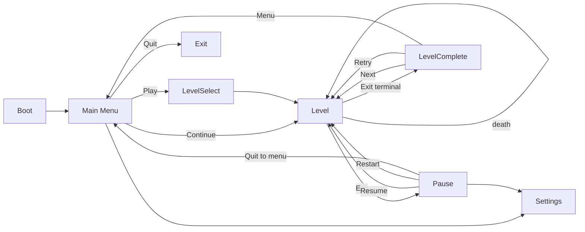

# SIGNAL LOST — UI / UX (v1.0)

## 1. Style rules
- Black / white / red only. White `#FFFFFF` for content, `#3D3D3D` for tracks/disabled, red `#E00000` only for: battery fill, awareness, hovered/selected item, warnings, danger icons.
- Font: **Rajdhani** (OFL). Medium for body, SemiBold for titles. Sizes at 1080p reference: HUD numbers 22, level name 26, menu buttons 30, title 96. Bundled at `res://assets/fonts/`; download from `https://github.com/google/fonts/tree/main/ofl/rajdhani` (files `Rajdhani-Medium.ttf`, `Rajdhani-SemiBold.ttf`, `OFL.txt`). If unavailable offline, use Godot default font and log in OPEN_QUESTIONS.
- Lines 1–2 px (scale with UI scale, never below 1 px), no panels, no gradients, no shadows.
- Safe margin: 4% of the shorter screen side (≈ 29 px at 720p, 43 px at 1080p). Anchors only — no absolute positions.
- One `Theme` resource: `res://resources/theme/ui_theme.tres` (default font, font sizes, `Button` styleboxes: normal = `StyleBoxFlat` bg transparent, border 1 px white; hover/focus = border 1 px red + font colour red; pressed = bg red α0.2; disabled = border `#3D3D3D`).
- Project: `display/window/stretch/mode = canvas_items`, `aspect = expand`, base 1280×720. Ultrawide: HUD anchors keep corners; centre items stay centred.

## 2. HUD (`scenes/ui/hud.tscn`, CanvasLayer 20)
```
HUD (CanvasLayer) hud.gd
└─ Root (Control, full rect, mouse_filter IGNORE, theme=ui_theme)
   ├─ SafeArea (MarginContainer, margins = safe margin)
   │  ├─ TopLeft (HBoxContainer, anchor TL)            fragment_counter.gd
   │  │   ├─ FragIcon (Control 18×18, _draw: broadcast glyph — dot + 2 arcs, white 1.5 px)
   │  │   └─ FragCount (Label "0", size 22)
   │  ├─ BottomLeft (VBoxContainer, anchor BL, separation 6)
   │  │   ├─ AbilityRow (HBoxContainer, separation 10)
   │  │   │   ├─ PrimarySlot (ability_slot.tscn: 44×44 icon, red silhouette of decoy beacon; KeyBadge 14×14 red 1 px outline + "F" 11 px top-right)
   │  │   │   └─ SecondarySlot (ability_slot.tscn: grey #3D3D3D icon, badge "G"; dim/locked = EMP stretch)
   │  │   ├─ Pips (HBoxContainer) pip_row.gd  — up to 3 diamond pips 8×8: filled white = charge, hollow 1 px = used
   │  │   └─ BatteryBar (Control 180×10) battery_bar.gd
   │  └─ BottomCentre (VBoxContainer, anchor BC, alignment centre)
   │      ├─ LevelName (Label "Level 4", size 26, centred)  level_label.gd
   │      └─ Progress (Control 220×2: track #3D3D3D, fill white)
   └─ (world elements live in LevelRoot/SenseLayer, see §3)
```
### BatteryBar (`battery_bar.gd`, custom `_draw`)
- Outline rect 1 px white; inner fill red `#E00000` width = `energy/max`.
- While charging: **ghost segment** — the rightmost `cost(affordable_tier)/max` portion of the fill drawn as white α0.35 (pending cost). If tier unaffordable, ghost turns hatched and the outline blinks red at 6 Hz.
- On pulse: fill tweens down over 0.12 s; a white "drain flash" remnant fades over 0.3 s.
- Energy 0: outline blinks red 2 Hz.
- Inputs: `Battery.energy_changed`, `PulseCharger.charge_changed / charge_started / pulse_released`.

### Progress line
`progress = 1 - clamp(path_dist(player → exit) / path_dist(spawn → exit), 0, 1)` using platform-graph path length, recomputed every 0.5 s; tween fill 0.3 s.

### Fragment counter
Shows `collected` (just the number, per screenshot style). Pop scale 1.3 → 1 on pickup.

## 3. World-space UI (in `SenseLayer`, unlit, follows camera)
| Element | Scene | Spec |
|---|---|---|
| Charge ring | `charge_rings.gd` on Player | white arc, 1.5 px, radius tweens to `tier.reveal_radius` (0.08 s ease out). Drawn as full circle; a 12-segment dash pattern when tier is downgraded |
| Noise warning ring | same | red `#E00000` α0.6, 1 px, radius `tier.noise_radius()` × mute factor if in M zone; dashes rotate slowly (20°/s) |
| Awareness bar | `awareness_bar.tscn` per enemy | 24×3 px red fill on `#5A0000` track, 14 px above head; visible only while `reveal_at(enemy) > 0.25`; fade 0.15 s |
| Reticle | `world_reticle.tscn` | 1 px white circle r 10 with 4 tick marks; types: PROJECTILE (follows projectile, red ticks), NOISE_ORIGIN (at enemy investigation target, pulses r 10→14 at 2 Hz, shown when enemy is revealed or 1 s after the noise), DECOY (around active decoy) |
| Alert glyphs | part of enemy Visual | see ANIMATION_AUDIO §3 |
| Hint signs | `hint_sign.tscn` | key glyph boxes (1 px white rect + Rajdhani 14 letter), lit-only (flat_reveal) |

## 4. Screens & flow

### Main menu (`main_menu.tscn`)
Black. Title "SIGNAL" white + "LOST" red, Rajdhani SemiBold 96, `title_glitch.gdshader` sonar wipe from centre (1.2 s) then glitch spikes every 3–6 s; a thin white sonar ring expands behind the title every 4 s (unshaded Control `_draw`). Buttons vertical, centred below: CONTINUE (hidden if no save), PLAY, SETTINGS, QUIT. Keyboard/gamepad focus first button; focus neighbour wrap.
### Level select
8 boxes (1 px outline, 120×80) in a 4×2 grid: number, best medal glyph (Ghost = hollow circle, Quiet = half circle, Loud = filled circle), fragments `n/3`. Locked levels `#3D3D3D`. Unlock = previous completed.
### Pause (`pause_menu.tscn`)
`get_tree().paused = true`; menu `process_mode = ALWAYS`. Background: black α0.6 over game. RESUME, RESTART, SETTINGS, QUIT TO MENU.
### Level complete (`level_complete.tscn`)
"SIGNAL RESTORED" types in (0.03 s/char). Stats table (two columns, white): Time, Pulses (W/N/S), Loudest, Detected, Fragments. Medal reveal: big glyph drawn with a sonar ring wipe; medal name (GHOST/QUIET/LOUD) in white, "NEW BEST" in red if improved. Fragment lore lines (one per found fragment, from `LevelData` header `lore_N` or default text). Buttons NEXT / RETRY / MENU.
### Settings (`settings_menu.tscn`)
| Setting | Control | Default | Applies |
|---|---|---|---|
| Master / Music / SFX volume | HSlider 0–100 | 80/70/80 | AudioServer bus volume_db = linear_to_db(v/100) |
| Screen shake | HSlider 0–100 | 100 | CameraRig multiplier |
| Film grain | CheckButton | on | post_fx.grain_amount |
| Chromatic aberration | CheckButton | on | post_fx.ca_amount gate |
| Colour-blind palette | CheckButton | off | Palette.set_colorblind() |
| Performance mode | CheckButton | off | GameConfig.sonar_quality LOW rules |
| Fullscreen | CheckButton | off | DisplayServer window mode |
Sliders: 1 px white track, red grabber line when focused. Saved immediately to `SaveData`.

## 5. Accessibility
Colour-blind mode (hatch danger), shake slider, grain/CA toggles, full gamepad navigation, all UI also keyboard navigable, hold-to-charge alternative: pressing `pulse` twice quickly (< 0.25 s) = Scream (documented in settings as "Quick scream", default off).
